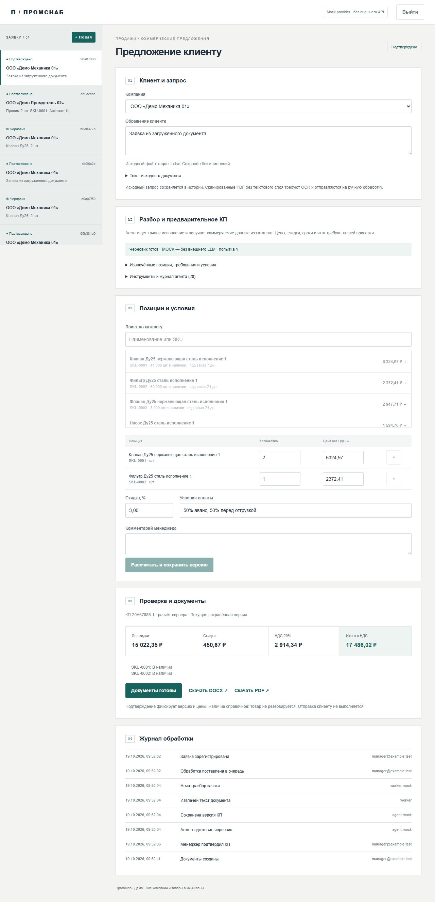
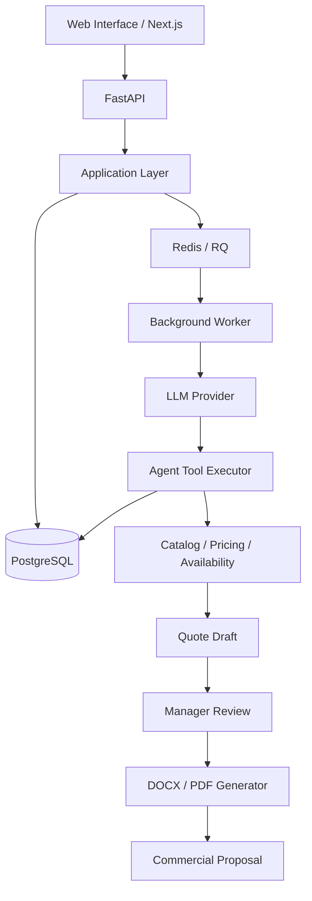

# Commercial Proposal Engine

**AI-powered B2B Commercial Proposal Automation**

Система автоматизации подготовки коммерческих предложений для промышленного B2B. Обрабатывает входящие заявки, извлекает номенклатуру и требования, сопоставляет позиции с каталогом, рассчитывает стоимость и формирует коммерческие предложения в DOCX и PDF.

Репозиторий представляет собой **обезличенную портфолио-версию рабочего решения** с воспроизводимой архитектурой, синтетическими бизнес-данными и возможностью самостоятельного развёртывания.

Коммерческие сведения, названия организаций, контакты, цены и остатки заменены вымышленными данными. Основные технические механизмы — обработка документов, агентные инструменты, расчёты, очереди задач, согласование и формирование КП — сохранены.



## Возможности

- Приём заявок в текстовом формате, XLSX, DOCX и PDF.
- Структурированное извлечение номенклатуры, количества и требований.
- AI-агент с типизированными инструментами и контролируемым выполнением действий.
- Поиск и сопоставление товаров с внутренним каталогом.
- Получение цен, остатков и условий поставки из базы данных.
- Расчёт скидок, НДС и итоговой стоимости.
- Обработка неоднозначных и неполных запросов.
- Ручная проверка, редактирование и подтверждение коммерческих предложений.
- Генерация DOCX и PDF с поддержкой кириллицы.
- Версионирование документов и сохранение истории изменений.
- Асинхронная обработка задач, повторные попытки и защита от дублирования.
- Журналирование действий агента, вызовов инструментов, ошибок и времени выполнения.

## Архитектура

Система построена как веб-приложение с разделением пользовательского интерфейса, API, прикладной бизнес-логики, агентного исполнения и фоновой обработки.



### Backend

Python, FastAPI, Pydantic 2, SQLAlchemy 2, Alembic.

API отвечает за создание заявок, управление версиями КП, авторизацию, обработку документов и взаимодействие с фоновыми задачами.

Расчёты и основные бизнес-правила вынесены в отдельный слой. Денежные операции выполняются через `Decimal`.

### Frontend

Next.js, TypeScript, Tailwind CSS.

Интерфейс позволяет работать с клиентами и каталогом, загружать документы, запускать автоматическую обработку, просматривать действия агента, согласовывать цены и скачивать готовые предложения.

### Data & Background Processing

PostgreSQL используется для хранения бизнес-сущностей, истории версий и событий аудита.

Redis и RQ обеспечивают асинхронную обработку заявок. Реализованы повторные попытки выполнения, идемпотентность операций, контроль состояния задач и защита от конкурентной обработки.

### AI Agent

Агент использует OpenAI-compatible интерфейс взаимодействия с языковыми моделями и ограниченный набор инструментов.

| Инструмент | Назначение |
|---|---|
| `get_customer` | Получение данных и условий клиента |
| `search_catalog` | Поиск и сопоставление номенклатуры |
| `get_price` | Получение актуальной цены |
| `check_availability` | Проверка остатков и сроков |
| `calculate_quote` | Расчёт коммерческого предложения |
| `create_quote_draft` | Создание черновика КП |

Вызовы инструментов валидируются через Pydantic. Агент не имеет доступа к произвольному SQL, системным командам или самостоятельному изменению коммерческих условий.

Цены, скидки, остатки и сроки извлекаются из контролируемых источников. При недостатке данных система инициирует уточнение или ручную проверку.

**Подтверждение коммерческого предложения всегда остаётся за менеджером.**

## Сценарий обработки

1. Менеджер регистрирует заявку или загружает документ.
2. Система сохраняет исходные данные и создаёт фоновую задачу.
3. Выполняется извлечение и структурирование содержимого.
4. Агент сопоставляет позиции с каталогом и запрашивает необходимые данные.
5. Детерминированная бизнес-логика рассчитывает стоимость.
6. Формируется черновик коммерческого предложения.
7. Менеджер проверяет позиции, корректирует условия и подтверждает версию.
8. Генерируются документы DOCX и PDF.
9. История обработки, действия агента и сформированные версии сохраняются.

Подтверждённая версия КП неизменна. Последующие изменения каталога и цен не влияют на сохранённые документы.

## Технологический стек

| Уровень | Технологии |
|---|---|
| Backend | Python, FastAPI, Pydantic |
| ORM / Migrations | SQLAlchemy, Alembic |
| Frontend | Next.js, TypeScript, Tailwind CSS |
| Database | PostgreSQL |
| Task Queue | Redis, RQ |
| AI | LLM API, Tool Calling, Structured Output |
| Document Processing | openpyxl, python-docx, pypdf |
| Document Generation | python-docx, LibreOffice |
| Infrastructure | Docker, Docker Compose |
| Testing | pytest, Playwright, GitHub Actions |

## Запуск

### Требования

- Docker Engine
- Docker Compose v2

Скопируйте конфигурацию окружения:

```bash
cp .env.example .env
```

Укажите собственные значения `POSTGRES_PASSWORD` и `DEMO_PASSWORD`.

Запустите приложение:

```bash
docker compose up -d --build
```

Загрузите демонстрационные данные:

```bash
docker compose exec api python seed.py
```

После запуска интерфейс доступен по адресу:

```text
http://localhost:3000
```

Учётная запись для демонстрации:

```text
Email: manager@example.test
Password: значение DEMO_PASSWORD из .env
```

Просмотр состояния контейнеров:

```bash
docker compose ps
```

Просмотр логов:

```bash
docker compose logs -f api worker web
```

Остановка:

```bash
docker compose down
```

Данные PostgreSQL, Redis и сгенерированные документы сохраняются в Docker volumes.

Инструкции для Linux VPS, HTTPS, резервного копирования и восстановления приведены в [Deployment Guide](docs/DEPLOYMENT.md).

## Конфигурация LLM

Поддерживаются два режима обработки.

**Mock mode** — воспроизводимый детерминированный режим, позволяющий проверить полный workflow без внешнего LLM API. Используется по умолчанию для локальной демонстрации и автоматизированного тестирования.

**OpenAI-compatible mode** — подключение внешнего LLM-провайдера с использованием Chat Completions API и tool calling.

Конфигурация задаётся через переменные окружения:

```env
LLM_PROVIDER=compatible
LLM_BASE_URL=https://api.openai.com/v1
LLM_MODEL=your-model
LLM_API_KEY=your-api-key
```

Провайдер и модель могут быть заменены без изменения прикладной бизнес-логики при условии поддержки необходимых API-возможностей.

## Демонстрационные данные

Все бизнес-данные репозитория синтетические. Они предназначены для воспроизводимой проверки функциональности без раскрытия информации реальных клиентов.

Датасет включает:

- 50 компаний-клиентов;
- 150 товарных позиций;
- 40 входящих заявок;
- 20 исторических коммерческих предложений;
- различные условия оплаты, скидки и сроки поставки;
- неполные, ошибочные и неоднозначные обращения.

Генерация данных детерминирована (`seed = 20261019`).

Повторное заполнение не создаёт дубликаты.

Для сброса отдельной демонстрационной базы:

```bash
docker compose exec api python seed.py --reset-demo --confirm-reset
```

**Внимание:** эта команда удаляет содержимое демобазы, включая аккаунты и КП.

## Тестирование и CI/CD

Проект включает модульные, интеграционные и браузерные E2E-тесты.

Проверяются:

- бизнес-расчёты, скидки и НДС;
- сопоставление позиций каталога;
- обработка неполных и неоднозначных заявок;
- валидация аргументов агентных инструментов;
- идемпотентность операций;
- конкурирующие задачи и повторные попытки;
- импорт документов;
- контроль версий и подтверждение КП;
- генерация DOCX/PDF;
- авторизация и ограничения API;
- полный пользовательский сценарий от заявки до готового документа.

В GitHub Actions настроены проверки backend, frontend и сквозной сценарий в Docker Compose с PostgreSQL, Redis, API, worker и веб-интерфейсом.

Сквозные Docker E2E-проверки выполняются в Linux-окружении CI.

Результаты проверок и эксплуатационные инструкции доступны в [Verification Report](docs/VERIFICATION.md).

## Безопасность

Основные механизмы:

- серверная валидация входных данных;
- ограничение доступных инструментов агента;
- контроль источников коммерческой информации;
- ограничения размера и структуры загружаемых файлов;
- защита от повторного выполнения операций;
- авторизация менеджера и серверные сессии;
- журналирование критичных действий;
- разделение подтверждения КП и автоматической подготовки;
- хранение секретов в переменных окружения;
- изоляция внутренних инфраструктурных сервисов.

Модель доверия, ограничения и рекомендации для внешнего развёртывания описаны в [Security Guide](docs/SECURITY.md).

## Документация

- [Architecture](docs/ARCHITECTURE.md) — компоненты, взаимодействие и архитектурные решения.
- [API Reference](docs/API.md) — HTTP-интерфейсы и контракты.
- [Data Model](docs/DATA_MODEL.md) — модель данных.
- [Deployment](docs/DEPLOYMENT.md) — запуск и эксплуатация.
- [Testing](docs/TESTING.md) — стратегия тестирования.
- [Demo Scenarios](docs/DEMO_SCENARIOS.md) — воспроизводимые сценарии.
- [Security](docs/SECURITY.md) — безопасность и ограничения.
- [Verification](docs/VERIFICATION.md) — результаты технических проверок.
- [Architecture Decision Record](docs/decisions/0001-architecture.md) — ключевые проектные решения.

## О проекте

Commercial Proposal Engine демонстрирует подход к разработке прикладных AI-систем, в которых языковая модель используется для интерпретации неструктурированных данных и оркестрации ограниченных действий, а критичная бизнес-логика остаётся детерминированной.

Основной инженерный принцип проекта — **LLM для интерпретации и принятия решений о вызове инструментов, программная логика для расчётов, проверки и исполнения**.

Портфолио-версия воспроизводит ключевые технические механизмы решения на обезличенных данных и предназначена для демонстрации архитектуры, интеграций, агентного исполнения и серверного развёртывания.