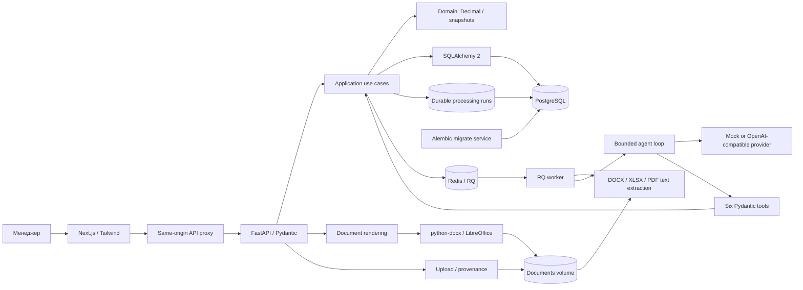
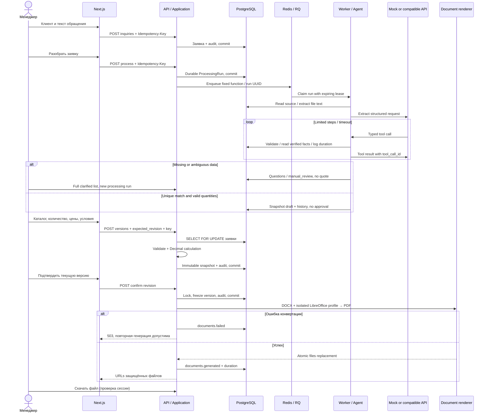

# Архитектура

FastAPI API, Next.js UI, PostgreSQL, Redis/RQ worker и файловый volume.
UI использует same-origin `/api` через ограниченный Next route handler;
реальный адрес API задаёт серверная переменная API_INTERNAL_URL.
Бизнес-правила находятся в application/domain. ORM и Session служат
инфраструктурой без дополнительного абстрактного repository wrapper.
API проверяет вход, сессию и делегирует use case.

Каждый черновик — новая QuoteVersion. Снимок включает реквизиты обеих сторон,
товары, каталоговую и выбранную цены, остатки, сроки, скидку, НДС, итоги,
оплату, дату и срок действия, комментарий. Изменение каталога, клиента или
конфига не меняет старое КП. История не выполняет live join для документов.

Конкуренция: PostgreSQL row lock на заявке, optimistic lock_version SQLAlchemy,
unique operation keys и (inquiry_id, revision), expected_revision от клиента.
Второй конкурентный запрос получает тот же результат после повтора либо 409.
Повтор подтверждения не дублирует событие. Генерация использует lock заявки,
проверяет существующую пару файлов и отдельный профиль LibreOffice.

Сбой между записью файлов и audit может оставить готовые файлы без generated
события; операция безопасно повторяется, но это не distributed transaction.
Восстановление документов — повторная генерация из снимка. Остатки справочные,
резервирование и списание не выполняются.

Tools: get_customer (клиент привязан к заявке), search_catalog (индекс извлечённой
строки), get_price/check_availability (только однозначно найденный product_id),
calculate_quote/create_quote_draft (без аргументов денег/скидок/условий).
Количество, единица и source spans сверяются с исходным текстом; упомянутые
SKU нельзя молча опустить. Техническое наименование берётся из каталога.
Условия запроса хранятся отдельно, не становятся обещаниями поставщика.

Провайдеры: mock выполняет детерминированный разбор и выдаёт tool calls;
compatible использует Chat Completions tool protocol, JSON extraction и
Pydantic validation. Free text модели не попадает в коммерческий документ.
По умолчанию 30 tool calls, 120 секунд агента, 20 секунд HTTP call, 4000 output
tokens. После полного цикла принимается только валидный final status=done.

ProcessingRun сохраняется до enqueue. Недоступный Redis не теряет заявку:
повтор с тем же ключом или retry ставит тот же run в очередь. JSONSerializer
используется и enqueue, и worker. По умолчанию RQ делает до двух повторов
ошибки. SQL CAS захватывает lease, tools проверяют claim token под row lock.
Старый worker после потери lease не может создать КП или перезаписать новый claim.
Если worker погиб после commit черновика, повтор находит QuoteVersion по
agent-run UUID и завершает run без дублирования. После аварии и истечения lease
можно повторить задачу; бесконечного неявного повторения нет.

Исходный файл хранится content-addressed в incoming/ volume, digest и имя — в
БД. Извлечённый текст сохраняется отдельно от исходного обращения. PDF сканы
без текста не распознаются: OCR не входит в текущую реализацию.
